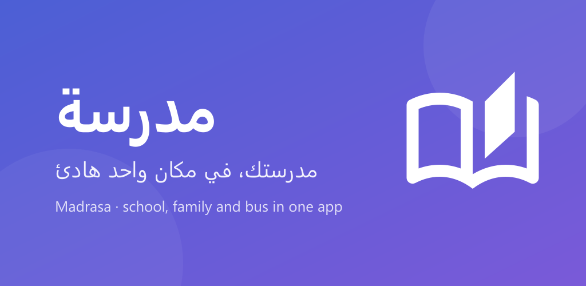
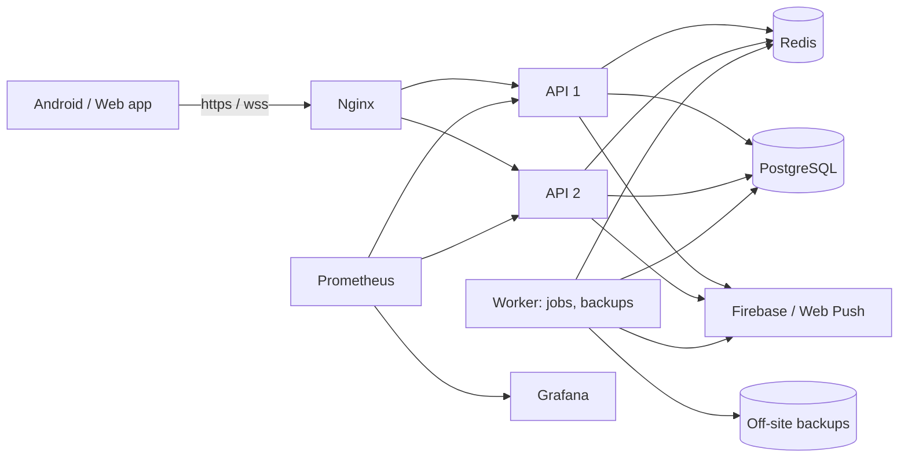

# مدرسة · Madrasa

**Live demo:** [madrasa-iq.duckdns.org](https://madrasa-iq.duckdns.org) (tap «جرّب التطبيق» to try any role)



A school app for Iraqi schools: one calm place for **students, parents,
teachers, the school office and bus drivers**. Arabic first (right to left)
with English, on Android and the web, backed by a Node.js server.

## What it does

| Role | Highlights |
|---|---|
| Student | Today's class and the next one, timetable, homework with hand-in, exams, grades and the Iraqi year result, study material, reminders |
| Parent | Each child's attendance the moment it is taken, grades, fees, the school bus live on a map with "near your stop" alerts, messages with teachers |
| Teacher | Take attendance per lesson, schedule exams and publish scores, set and grade homework, share PDFs, videos and links |
| School office | The school today (who is in, which lessons are taken, what happened and when), people and accounts, classes, timetable, holidays, fees, announcements, bus lines and stops |
| Bus driver | Start a trip, share the bus location (screen off too), boarding and absences |

Also: real-time chat with seen ticks, edit and delete; push notifications;
offline reading; a "Try the app" demo school that resets every night.

## Tech

| Layer | Stack |
|---|---|
| App | Flutter, Riverpod, go_router, flutter_map (OpenStreetMap), Firebase Cloud Messaging, Web Push |
| Server | Node.js, Express 5, PostgreSQL (PGlite locally, Neon online), Redis, BullMQ, WebSocket, Zod |
| Infrastructure | Docker, Nginx (two API copies, load balancing, TLS), Terraform (AWS, Oracle Cloud), GitHub Actions |
| Monitoring | Prometheus, Grafana, Loki, Alertmanager (Telegram), node exporter, cAdvisor |



## Engineering notes

- **Real time:** WebSocket live updates fanned out through Redis pub/sub, so
  any number of API copies stay in sync; polling only as a fallback.
- **Caching:** per-user GET cache in Redis, invalidated for the whole school on
  any change (a version number per school); stale-while-revalidate on the
  phone with ETags and a 304 for unchanged data.
- **Background jobs:** BullMQ with Baghdad-time schedules (exam reminders,
  fee reminders, summaries, nightly backup with an off-site copy).
- **Security:** see [docs/SECURITY_AUDIT.md](docs/SECURITY_AUDIT.md): token
  purposes, rate limits and lockout, upload checks (type sniffing, EXIF/GPS
  removal), CSP, IDOR tests, constant-time sign-in.
- **Bus tracking:** Android foreground service for the driver, GPS accuracy
  and phone-clock corrections, stops detected from the route.

## Run it

```bash
# Server (PGlite: nothing to install)
cd server && npm install && npm start          # http://localhost:3000

# App against the server
flutter run --dart-define=API_URL=http://localhost:3000

# App with mock data, no server
flutter run
```

Demo accounts on a local server: `STU-2026-0142`, `PAR-2026-0142`,
`TCH-2019-0031`, `ADM-2020-0001`, `DRV-2024-0012` (password `demo1234`).

## Tests

```bash
cd server && npm test           # server, on PGlite
cd server && npm run test:pg    # server, on a real PostgreSQL
flutter test                    # app, including every page in Arabic
```

CI runs these plus CodeQL, Gitleaks, Trivy, Hadolint and npm audit on every
push; `main` deploys with a rolling, health-checked update.

## Deploying

See [deploy/README.md](deploy/README.md): Terraform for the server, a
hardening script (SSH keys only over Tailscale, fail2ban, firewall), Docker
Compose for the stack, Let's Encrypt, and GitHub Actions.

---

© 2026 · All rights reserved.
